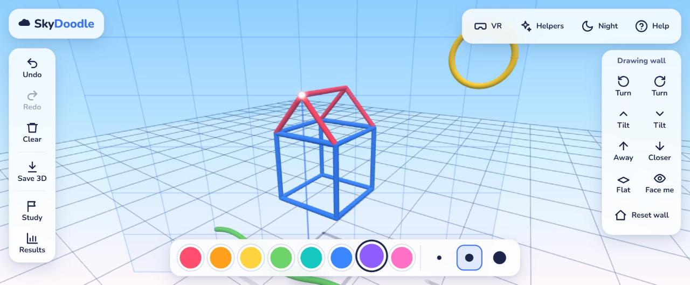
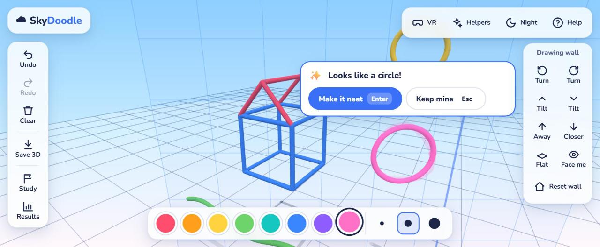
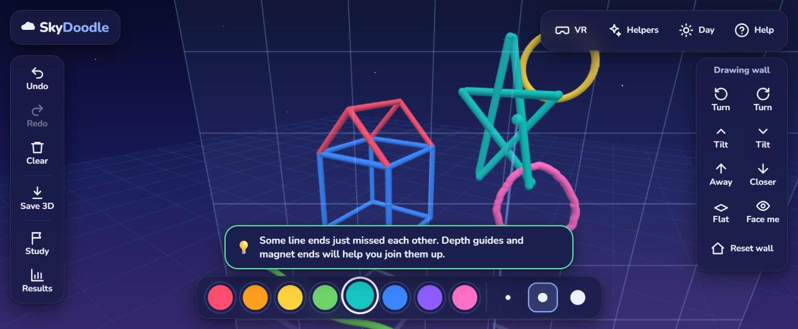
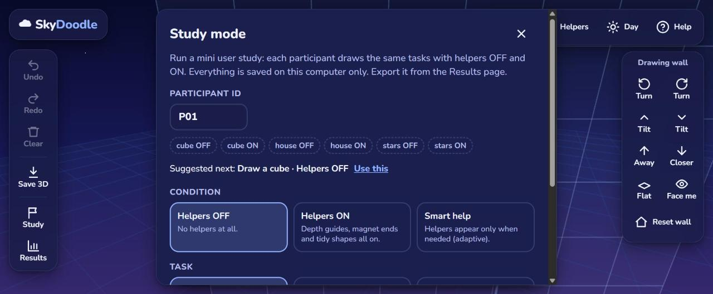
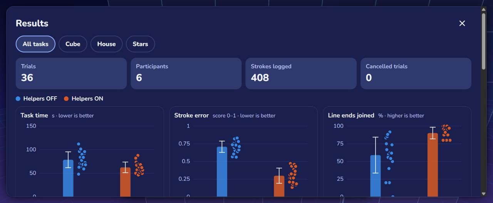

# ☁️ SkyDoodle

**An assisted 3D sketching tool for beginner and young creators, on the desktop and in VR.**

SkyDoodle lets you draw glowing tubes in 3D space with a mouse, a finger, or a VR controller. What makes it different is a set of **assistance features** that tackle the hardest part of 3D sketching for beginners, *judging depth*, and an **adaptive helper** that switches them on when someone is struggling and fades them away as they improve. A built-in **study mode** logs every stroke so the effect of that help can be measured.

> **Live demo:** **[boyraheem.github.io/3D-prototype](https://boyraheem.github.io/3D-prototype/)**: works in any modern browser; open it in the Meta Quest Browser and press **VR** to draw in mid-air.



---

## Research question

> **Can adaptive visual guides help novice creators draw more accurately in 3D?**

People new to 3D sketching consistently misjudge depth: lines that look connected from one angle are centimetres apart from another. SkyDoodle explores whether guides that appear *when they are needed* (and disappear when they are not) can improve accuracy without becoming a crutch.

The app is both the **intervention** (the assistance features) and the **instrument** (stroke logging, task scoring, a counterbalanced study protocol and a results page).

---

## Features

### Drawing
- Smooth 3D tubes built from sampled points with **centripetal Catmull-Rom** smoothing
- **8 bright, named colours** and **3 brush sizes**
- **Undo / redo**, including undoing *Clear* (so no scary "are you sure?" dialogs)
- **Export as .glb** (opens in Blender, Windows 3D Viewer, online glTF viewers, game engines)
- **Desktop mode:** draw on a movable see-through *drawing wall*: push/pull it with the scroll wheel, turn and tilt it, lay it flat; right-drag to orbit
- **VR mode (WebXR):** draw in mid-air with the controller trigger; a *wrist palette* on the other hand; tested target: Meta Quest Browser

### Assistance (each can be switched on/off in **Helpers**)
| Helper (child-friendly name) | What it does |
|---|---|
| **Depth guides** | A drop line from the brush tip to the floor, a soft tip shadow, floor shadows of every stroke, and a "reach line" to the nearest stroke that turns green when you touch it |
| **Magnet ends** (smart snapping) | When the tip comes near a stroke's end, a glowing marker appears and the stroke snaps exactly onto it, including closing a shape onto its own start. In VR the controller vibrates |
| **Tidy shapes** (beautification) | After a stroke, detects a near-line, circle or arc (least-squares fit + error threshold) and *offers* a clean version, showing your original faintly. Your choice: **Make it neat** or **Keep mine** |
| **Smart help** (adaptive) | Tracks wobble and missed connections over the session, turns helpers on when you struggle and fades them out as you improve, always with a short message explaining why |





### Study mode, logging and results
- **Guided tasks:** *Draw a cube*, *Draw a house*, *Connect the stars* (six stars at different depths), with a timer
- **Conditions:** Helpers OFF / Helpers ON / Smart help, fixed for the duration of a trial
- **Counterbalanced order** (odd participants start with OFF, even with ON) with a "suggested next trial" button
- **Every stroke logged:** timestamp, duration, point count, path length, mean jitter, wobble, depth variance, missed connections, whether snapping/beautification fired (and the user's decision), which helpers were active, desktop or VR
- **Export:** trials CSV, strokes CSV, everything as JSON (data never leaves the computer otherwise)
- **Results page:** task time, stroke error, line ends joined and star distance per condition: mean with ±1 SD and every trial as a dot, plus a summary table with mean ± SD, Cohen's *d* and Welch's *t*




*Results screenshot uses simulated demo data, not real participants.*

### Design and accessibility
- Playful but clean: rounded 48 px+ buttons, a friendly **3-step onboarding**, a **day / night sky**
- Every button has a visible text label and a spoken label; a full **keyboard shortcut** set (press **?**)
- No text below 14 px; visible focus rings; respects *reduced motion*; works down to phone width (icon-only toolbars there, still labelled for screen readers)
- Colourblind-safe chart colours, validated for both themes

> 🎬 *GIF placeholder:* `docs/demo.gif` *(record ~10 s of drawing a house with helpers on: e.g. with ScreenToGif or the browser's screen recorder)*

---

## Running it

Requirements: **Node.js 20.19+** (or 22.12+) and npm.

```bash
npm install
npm run dev          # http://localhost:5173
```

| Command | What it does |
|---|---|
| `npm run dev` | Development server with hot reload |
| `npm run dev:https` | Same, over HTTPS with a self-signed certificate, for testing on a **VR headset** on your Wi-Fi |
| `npm test` | Unit tests (shape fitting, metrics, adaptive logic, statistics, CSV, task scoring, VR input) |
| `npm run build` | Type-check and build the static site into `dist/` |
| `npm run preview` | Serve the built site locally |

Useful URL flags: `?stress=500` (adds 500 random strokes and shows the performance meter), `?debug` (performance meter; also toggle with the **`** key).

### Trying VR on a Meta Quest
WebXR only runs on secure (HTTPS) pages. Either:
1. **Deploy** (below) and open the GitHub Pages URL in the Quest Browser, or
2. run `npm run dev:https`, open `https://<your-PC's-IP>:5173` in the Quest Browser, accept the certificate warning once, and press **VR**.

**VR controls:** trigger = draw · thumbstick ←/→ = colour, ↑/↓ = brush size · **A/X** = "make it neat" · **B/Y** = "keep mine" or undo · touch a ball on the **wrist palette** with the brush tip to pick it · during a study task, touch **Done** on the wrist and pull the trigger.

### Desktop controls (press **?** in the app for the full list)
| | |
|---|---|
| Draw | left-drag (or one finger) |
| Look around | right-drag, or hold **Space** + drag; two fingers on touch |
| Zoom | **Ctrl** + scroll, or pinch |
| Push / pull the drawing wall | scroll wheel, or **W / S** |
| Turn / tilt the wall | **Q / E** or **← / →**, **↑ / ↓**; **F** flat, **V** face me, **R** reset |
| Colour / size | **1–8**, **[ / ]** |
| Undo / redo / clear / save | **Ctrl+Z**, **Ctrl+Y**, **Delete**, **Ctrl+S** |
| Helpers | **H** panel; **G / M / B / A** toggle each helper |

---

## Running a mini study

1. Open **Study**, type a participant ID (it suggests the next one).
2. Click **Use this** to follow the counterbalanced order, then **Start task**. Read the participant the instruction shown.
3. The participant draws; you press **Done** (or **Cancel**). The next suggested trial is pre-selected.
4. Open **Results** to compare conditions, and export **Trials CSV** / **Strokes CSV** / **JSON** for your own analysis (R, Python, Excel).

Suggested protocol: 6–10 participants × 3 tasks × 2 conditions (OFF, ON), ~15 minutes each, with a short practice drawing first. Add *Smart help* as a third condition to test the adaptive question directly. With a sample this small, report results as exploratory (descriptive statistics and effect sizes), as the results page does.

### Data dictionary (main fields)
| Field | Meaning |
|---|---|
| `durationMs`, `pointCount`, `pathLength` | Stroke time (ms), samples kept, length (m) |
| `meanJitter` | Mean distance of each point from the midpoint of its neighbours, resampled every 5 mm (m): high-frequency shake |
| `wobble` | RMS distance between the stroke and a smoothed copy of itself (±2.5 cm window) (m): visible waviness |
| `depthVariance` | Variance of the points' distance from the viewer along the view direction (m²) |
| `missedConnections` | Stroke ends (0–2) that stop within 12 cm of another end without touching it |
| `errorScore` | 0–1 combination of wobble and missed connections |
| `snappedStart`, `snappedEnd` | Whether Magnet ends locked the stroke's start/end |
| `beautifyOffered`, `beautifyFitError`, `beautifyOutcome` | Shape offered (line/circle/arc), its normalised fit error, and accepted / declined / ignored |
| `assist*` | Which helpers were in effect while the stroke was drawn |
| Trial: `connectedPct`, `starErrorCm`, `starsHitPct` | % of stroke ends joined in the final drawing; mean star-to-drawing distance; % of stars reached within 4 cm |

---

## How it's built

**Three.js + WebXR, Vite, TypeScript (strict), no backend** — a static site. UI is plain TypeScript and DOM (no framework); charts are hand-written SVG.

```
src/
  main.ts                 wires every module together; the render loop
  app/        state.ts (settings store), scene.ts (renderer, camera, floor, adaptive resolution), events.ts
  drawing/    DrawingPlane, DesktopInput, DrawingController (input-independent pipeline), StrokeBuilder,
              StrokeMesh (Catmull-Rom tubes), StrokeStore (undo/redo), StrokeBatch (one draw call), exportGlb
  guides/     DepthGuides, StrokeShadows, SpatialIndex (fast nearest-point queries)
  snapping/   Snapper
  beautify/   fit.ts (line / plane / Kåsa circle fitting), Beautifier (the offer UI)
  adaptive/   metrics.ts (jitter, wobble, depth variance, missed connections), AdaptiveHelper
  logging/    InteractionLog, csv.ts, stats.ts
  study/      tasks.ts (tasks, scoring, counterbalancing), StudyMode, StarField
  xr/         VRMode, WristPalette, VRLabel, SkyDome, xrInput
  ui/         Toolbar, AssistPanel, AdaptiveIndicator, StudyPanel, ResultsPage, Onboarding, shortcuts …
```

The central design decision: **input sources only produce a stream of brush-tip positions** (`setTip / begin / extend / end`). The mouse-on-a-wall and the VR controller are just two such sources, so every assistance feature, the logging and the study tasks work identically in both modes.

**Performance (target 60 fps with 500 strokes):** all strokes render through a `BatchedMesh` (1 draw call instead of ~1,000 with floor shadows); tubes use ~1 ring per centimetre; Lambert shading on screen (PBR materials in the export); nearest-stroke queries use a spatial hash (~12 µs); resolution adapts if frames run slow; foveated rendering in VR. Measured on an Intel UHD 620 laptop GPU: 500 strokes ≈ 12.7 ms per frame *including* a forced GPU sync (strokes only), +5 ms with floor shadows. Check your machine with `?stress=500`.

See **[DESIGN.md](DESIGN.md)** for why each assistance technique works the way it does.

---

## Deploying

The repo includes a GitHub Actions workflow (`.github/workflows/deploy.yml`) that tests, builds and publishes to **GitHub Pages** on every push to `main`.

1. Push this project to a GitHub repository.
2. In the repository: **Settings → Pages → Source: GitHub Actions**.
3. Push to `main`. The site appears at `https://<user>.github.io/<repo>/` (for this repo: https://boyraheem.github.io/3D-prototype/). The workflow sets the correct base path from the repo name.

For Vercel/Netlify or a custom domain, build with `VITE_BASE=/ npm run build` and publish `dist/`.

---

## Limitations

- **Not yet tested on a real headset.** VR mode was developed against the WebXR API and exercised with simulated controllers in a desktop browser; comfort details (standing distance, label sizes, palette placement) need tuning on a Quest.
- **Thresholds are first guesses.** Beautification thresholds were tuned on synthetic strokes; wobble and adaptive-help thresholds (`WOBBLE_REF`, EMA weights) are not yet calibrated on real children's drawings. All are named constants, easy to adjust.
- **Desktop depth is plane-based.** With a mouse, depth comes from moving the drawing wall: a deliberate, well-known technique, but different from free 3D drawing in VR, so desktop and VR results should be analysed separately (`inputMode` is logged).
- **"Missed connection" is a heuristic.** An end that stops near another end might be intentional; the 12 cm window is a judgement call.
- **Task scores are simple.** Cube/house accuracy is "% of ends joined", not a comparison to an ideal shape; only *Connect the stars* has a ground truth.
- **Small-sample statistics.** Welch's *t* and Cohen's *d* are shown as exploratory indicators; a real study needs more participants and a pre-registered analysis.
- **Data lives in one browser.** Logs are stored in `localStorage` (cleared if the browser's site data is cleared). Export after every session.
- **No drawing without a pointer.** Every *control* is keyboard-accessible, but drawing itself needs a mouse, touch or controller.
- **Children's data:** if you run sessions with minors, get guardian consent and follow your institution's ethics process; the app collects no names, only the IDs you type.

---

## Credits

Built with [three.js](https://threejs.org) (rendering, WebXR, glTF export, controller models), [Vite](https://vitejs.dev), [TypeScript](https://www.typescriptlang.org) and [Vitest](https://vitest.dev). Font: [Nunito](https://fonts.google.com/specimen/Nunito). Chart colours follow a colourblind-safe categorical palette validated for both themes.
